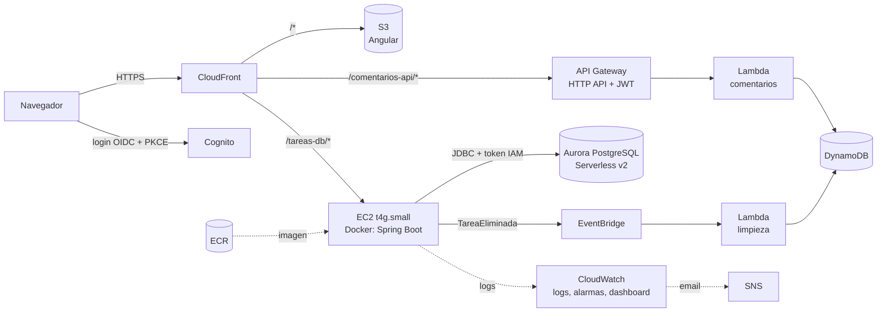

# Tareas AWS

Aplicación full stack de gestión de tareas con comentarios, desplegada en AWS. Es un proyecto de aprendizaje de desarrollo cloud con **Java (Spring Boot)** y **Angular**, construido por fases:

| Fase | Contenido |
|------|-----------|
| 0–1 | Frontend Angular en S3 + CloudFront, con CI/CD |
| 2 | Backend Spring Boot en EC2 + Aurora PostgreSQL Serverless (autenticación IAM) |
| 3 | Backend en contenedor Docker (imagen en ECR) |
| 4 | Microservicio de comentarios: Lambda Java 21 + SnapStart + DynamoDB (SAM) |
| — | Autenticación con Cognito (OIDC + PKCE), tareas por usuario, limpieza con EventBridge |
| 5 | Toda la infraestructura en Terraform, con pipeline (plan automático, apply manual) |
| — | Observabilidad: logs en CloudWatch, alarmas por email y dashboard |

**URL:** https://d1tqw0yq09gni5.cloudfront.net

---

## Índice

1. [Arquitectura](#1-arquitectura)
2. [Tecnologías](#2-tecnologías)
3. [Estructura del repositorio](#3-estructura-del-repositorio)
4. [Desarrollo local](#4-desarrollo-local)
5. [Pipelines (GitHub Actions)](#5-pipelines-github-actions)
6. [Recrear el repositorio de GitHub](#6-recrear-el-repositorio-de-github)
7. [Levantar todo desde 0 en una cuenta AWS nueva](#7-levantar-todo-desde-0-en-una-cuenta-aws-nueva)
8. [Operación diaria](#8-operación-diaria)
9. [Qué hacer cuando suena una alarma](#9-qué-hacer-cuando-suena-una-alarma)
10. [Respaldos y restauración](#10-respaldos-y-restauración)
11. [Decisiones y limitaciones](#11-decisiones-y-limitaciones)
12. [Solución de problemas](#12-solución-de-problemas)

---

## 1. Arquitectura



**Flujo de una petición:**

1. El usuario inicia sesión en Cognito. Angular recibe un *access token* (JWT).
2. Todas las peticiones pasan por un solo dominio de CloudFront, así que no hay problemas de CORS:
   - `/*` → S3: los archivos de Angular. La función `spa-rewrite` envía las rutas de Angular a `index.html`.
   - `/tareas-db/*` → la EC2, puerto 8888. El security group solo acepta IPs de CloudFront.
   - `/comentarios-api/*` → API Gateway.
3. **Spring Boot** valida el JWT: la firma, el emisor, el `client_id` y que sea un *access token*. Usa el `sub` del token para mostrar solo las tareas de ese usuario.
4. **API Gateway** valida el JWT con su *authorizer* antes de invocar la Lambda. La Lambda usa el `sub` para filtrar y borrar comentarios.
5. Al borrar una tarea, el backend publica `TareaEliminada` en EventBridge, y la Lambda de limpieza borra sus comentarios.

**Seguridad:**

- Sin contraseñas en el código:
  - Aurora usa autenticación IAM.
  - La EC2 obtiene sus permisos de su rol.
  - Las access keys de GitHub viven solo en *Secrets*.
- Cada usuario solo ve y modifica sus propias tareas y comentarios. Si pide uno ajeno, recibe `404`.

---

## 2. Tecnologías

### Frontend

| Tecnología | Uso |
|---|---|
| Angular 22 (standalone, signals) | SPA |
| angular-auth-oidc-client | Login OIDC con Cognito (Authorization Code + PKCE), renovación con refresh token |
| Bootstrap | Estilos |
| Vitest | Tests |

### Backend (`backend/tareas-db`)

| Tecnología | Uso |
|---|---|
| Java 21 + Spring Boot 4.1 | API REST (`/tareas-db/api/v1/tareas`) |
| Spring Data JPA + Hibernate | Acceso a datos (`ddl-auto=validate`) |
| Flyway | Migraciones versionadas (`src/main/resources/db/migration`) |
| Spring Security OAuth2 Resource Server | Validación de JWT de Cognito |
| AWS Advanced JDBC Wrapper (plugin IAM) | Conexión a Aurora con token IAM en vez de contraseña |
| HikariCP (`minimum-idle=0`) | Pool que se vacía para que Aurora pueda pausarse |
| AWS SDK v2 (EventBridge) | Publicar eventos de dominio |
| springdoc-openapi | Swagger UI en `/tareas-db/api/swagger-ui.html` |
| Spring Boot Actuator | Health en `/tareas-db/api/health` |
| Docker (multi-stage, capas) | Imagen arm64 con Corretto 21 |

### Microservicio de comentarios (`serverless/comentarios`)

| Tecnología | Uso |
|---|---|
| AWS SAM | Plantilla y despliegue (CloudFormation) |
| Lambda Java 21 arm64 + SnapStart | API de comentarios, con *priming* CRaC para reducir el arranque en frío |
| API Gateway HTTP API | Rutas + *authorizer* JWT de Cognito |
| DynamoDB (on-demand) | Tabla `tareas-comentarios` (PK `tareaId`, SK `comentarioId`) |
| EventBridge | Regla `TareaEliminada` → Lambda de limpieza |

### Infraestructura y operación

| Tecnología | Uso |
|---|---|
| Terraform 1.16 + provider AWS 6.x | Toda la infraestructura (`infra/`), state en S3 con bloqueo nativo |
| GitHub Actions | 4 pipelines de CI/CD |
| CloudFront + S3 (OAC) | Hosting y puerta de entrada única |
| EC2 t4g.small (Graviton) + Elastic IP | Corre el contenedor del backend |
| ECR | Imágenes Docker (inmutables, se guardan las últimas 5) |
| Aurora PostgreSQL 17 Serverless v2 (Express) | Base de datos, escala a 0 ACU |
| Cognito (Essentials) | Usuarios y login |
| SSM Run Command | Despliegue en la EC2 sin abrir SSH al pipeline |
| CloudWatch + SNS | Logs, 6 alarmas, dashboard y avisos por email |

---

## 3. Estructura del repositorio

```
tareas-aws/
├── frontend/                     Angular
│   ├── src/app/auth.config.ts      issuer y clientId de Cognito
│   └── proxy.conf.json             proxy de "ng serve" hacia el backend y el API
├── backend/tareas-db/            Spring Boot
│   ├── Dockerfile
│   ├── deploy/deploy-contenedor.sh script que el pipeline ejecuta en la EC2 vía SSM
│   ├── esquema-tareas.md           esquema de la base de datos
│   └── src/main/resources/
│       ├── application.properties      configuración base (y desarrollo local)
│       ├── application-aws.properties  perfil "aws": Aurora con IAM, eventos activos
│       └── db/migration/               V1..V5 (Flyway)
├── serverless/comentarios/       SAM
│   ├── template.yaml
│   ├── samconfig.toml
│   └── function/                   código Java de las Lambdas
├── infra/                        Terraform
│   ├── versions.tf  variables.tf  locals.tf  outputs.tf
│   ├── s3.tf  cloudfront.tf  cognito.tf  ec2.tf  aurora.tf
│   ├── iam.tf  ecr.tf  ci-terraform.tf  observabilidad.tf
│   └── cloudfront/spa-rewrite.js
└── .github/workflows/
    ├── deploy-frontend.yml
    ├── deploy-backend.yml
    ├── deploy-comentarios.yml
    └── terraform.yml
```

---

## 4. Desarrollo local

### Requisitos

- Java 21 (Corretto), Node 22, Docker Desktop
- AWS CLI v2, SAM CLI, Terraform 1.16.x
- Git Bash en Windows (ver [Solución de problemas](#12-solución-de-problemas))

### Backend contra un PostgreSQL local

```bash
# 1) Base de datos local
docker run -d --name tareas-pg -p 5432:5432 \
  -e POSTGRES_DB=tareas -e POSTGRES_USER=app -e POSTGRES_PASSWORD=app123 postgres:17

# 2) Backend (perfil por defecto: PostgreSQL con usuario y contraseña, eventos desactivados)
cd backend/tareas-db
DB_HOST=localhost DB_PORT=5432 DB_NAME=tareas DB_USER=app DB_PASSWORD=app123 ./mvnw spring-boot:run
```

- Swagger: http://localhost:8888/tareas-db/api/swagger-ui.html
- Health: http://localhost:8888/tareas-db/api/health
- La API exige un JWT real de Cognito. Lo más simple es obtenerlo iniciando sesión desde el frontend local.
- En una base nueva, la migración V5 borra las tareas de ejemplo de la V2, porque no tienen dueño. La lista empieza vacía para cada usuario.

### Frontend

```bash
cd frontend
npm ci
npm start          # ng serve con proxy.conf.json → http://localhost:4200
```

El proxy envía `/tareas-db` al backend local (`localhost:8888`) y `/comentarios-api` al API Gateway real. `http://localhost:4200/` ya está registrado como callback en Cognito.

### Imagen Docker del backend

```bash
docker build -t tareas-db backend/tareas-db
```

### Microservicio de comentarios

```bash
cd serverless/comentarios
sam validate --lint
sam build
```

---

## 5. Pipelines (GitHub Actions)

| Workflow | Se ejecuta con | Qué hace |
|---|---|---|
| `deploy-frontend.yml` | push en `frontend/**` | `ng build` → `s3 sync` → invalida CloudFront |
| `deploy-backend.yml` | push en `backend/**` | Tests con Postgres 17 → imagen arm64 a ECR → deploy en la EC2 vía SSM (con vuelta atrás automática) → smoke test (health 200, API 401) |
| `deploy-comentarios.yml` | push en `serverless/comentarios/**` | `sam validate` → `sam build` → `sam deploy` con el rol de CloudFormation → smoke test (401) |
| `terraform.yml` | push en `infra/**` → **plan** · *Run workflow* con `aplicar=true` → **plan + apply** | `fmt -check`, `validate`, `plan`, y `apply` solo de forma manual |

Todos se pueden ejecutar a mano desde **Actions → (workflow) → Run workflow**.

---

## 6. Recrear el repositorio de GitHub

Usa esto si se borra el repositorio pero la infraestructura de AWS sigue existiendo.

### 6.1 Subir el código

```bash
gh repo create tareas-aws --private          # o desde github.com → New repository
git remote set-url tareas-aws https://github.com/<tu-usuario>/tareas-aws.git
git push -u tareas-aws master
```

> Los pipelines fallarán en este primer push porque todavía no hay secrets. Configúralos y vuelve a ejecutarlos.

### 6.2 Secrets

Van en **Settings → Secrets and variables → Actions → Secrets**.

| Secret | Usuario IAM | Lo usan |
|---|---|---|
| `AWS_ACCESS_KEY_ID` / `AWS_SECRET_ACCESS_KEY` | `github-deploy` | frontend, backend, comentarios |
| `TF_PLAN_AWS_ACCESS_KEY_ID` / `TF_PLAN_AWS_SECRET_ACCESS_KEY` | `github-terraform-plan` (solo lectura) | terraform (plan) |
| `TF_APPLY_AWS_ACCESS_KEY_ID` / `TF_APPLY_AWS_SECRET_ACCESS_KEY` | `github-terraform-apply` (admin) | terraform (apply) |

Las claves secretas no se pueden volver a leer, así que hay que **crear claves nuevas**. Cada usuario admite como máximo 2. Ejecuta esto con tu perfil de administrador:

```bash
P="--profile tareas-local --region us-east-2"
for U in github-deploy github-terraform-plan github-terraform-apply; do
  echo "== $U"; aws iam list-access-keys --user-name $U --query "AccessKeyMetadata[].AccessKeyId" --output text $P
done

# Borra las claves viejas (ya no se pueden recuperar) y crea una nueva por usuario
aws iam delete-access-key --user-name github-deploy --access-key-id AKIA... $P
aws iam create-access-key --user-name github-deploy \
  --query "AccessKey.[AccessKeyId,SecretAccessKey]" --output text $P
```

Con `gh` puedes cargarlas sin copiarlas a ningún archivo:

```bash
gh secret set AWS_ACCESS_KEY_ID          # te pide el valor
gh secret set AWS_SECRET_ACCESS_KEY
# ... y lo mismo para TF_PLAN_* y TF_APPLY_*
```

### 6.3 Variables

Van en **Settings → Secrets and variables → Actions → Variables**. No son secretas.

| Variable | Valor | Cómo obtenerlo |
|---|---|---|
| `S3_BUCKET` | `tareas-frontend-mario-2026` | `infra/s3.tf` |
| `CF_DIST_ID` | ID de la distribución | `terraform -chdir=infra output -raw cloudfront_distribution_id` |
| `CF_DOMAIN` | `d1tqw0yq09gni5.cloudfront.net` (sin `https://`) | `terraform -chdir=infra output -raw cloudfront_dominio` |
| `EC2_INSTANCE_ID` | `i-...` | ver el comando abajo |
| `SAM_BUCKET` | bucket de SAM | `locals.sam_bucket` en `infra/locals.tf` |
| `CFN_EXEC_ROLE_ARN` | ARN de `comentarios-cfn-exec` | ver el comando abajo |
| `ALERTAS_EMAIL` | email que recibe las alarmas | — |

```bash
P="--profile tareas-local --region us-east-2"
aws ec2 describe-instances --filters "Name=tag:Name,Values=tareas-backend" \
  --query "Reservations[0].Instances[0].InstanceId" --output text $P
aws iam get-role --role-name comentarios-cfn-exec --query Role.Arn --output text $P
```

O todas juntas con `gh`:

```bash
gh variable set S3_BUCKET --body tareas-frontend-mario-2026
gh variable set CF_DOMAIN --body d1tqw0yq09gni5.cloudfront.net
# ...
```

### 6.4 Verificar

1. **Actions → Terraform (infra) → Run workflow** sin marcar `aplicar`. Debe terminar con **No changes**.
2. Ejecuta a mano `Deploy Frontend`, `Deploy Backend` y `Deploy Comentarios`. Los tres deben terminar en verde.

---

## 7. Levantar todo desde 0 en una cuenta AWS nueva

> Hay dependencias circulares: CloudFront necesita el API de SAM, SAM necesita Cognito, y el cliente de Cognito necesita el dominio de CloudFront. Por eso el orden importa. Calcula **unas 2 horas**.

### 7.1 Requisitos

- Cuenta AWS con MFA en el usuario raíz y un presupuesto (*Budget*) con alerta.
- Un usuario o perfil administrador en tu PC. Aquí se usa el perfil `tareas-local` (`aws login`).
- Las herramientas de la [sección 4](#4-desarrollo-local).

```bash
export AWS_PROFILE=tareas-local AWS_REGION=us-east-2
export MSYS_NO_PATHCONV=1      # solo en Git Bash
aws sts get-caller-identity
```

### 7.2 Ajustar los valores propios de la cuenta

Los nombres de buckets y el dominio de Cognito son **únicos en todo el mundo**: cambia el sufijo `mario-2026` en todos los lugares donde aparezca.

| Archivo | Qué cambiar |
|---|---|
| `infra/versions.tf`, `infra/ci-terraform.tf` | bucket del state (`tareas-tfstate-...`) |
| `infra/s3.tf` | bucket del frontend |
| `infra/cognito.tf` | `aws_cognito_user_pool_domain.login.domain` |
| `infra/ec2.tf` | `ami` (Amazon Linux 2023 **arm64** de la región), `subnet_id`, `key_name`, `ip_admin_ssh` |
| `infra/locals.tf` | `sam_bucket` (se conoce en el paso 7.6) |
| `infra/aurora.tf` | `engine_version` y la zona de disponibilidad de la instancia, si cambian |

Los valores de Cognito (issuer, client id, dominio) se actualizan en el paso 7.8.

### 7.3 Bucket del state de Terraform

Es lo único que se crea a mano, porque Terraform lo necesita antes de existir:

```bash
B=tareas-tfstate-<sufijo>
aws s3api create-bucket --bucket $B --create-bucket-configuration LocationConstraint=us-east-2
aws s3api put-bucket-versioning --bucket $B --versioning-configuration Status=Enabled
aws s3api put-public-access-block --bucket $B --public-access-block-configuration \
  BlockPublicAcls=true,IgnorePublicAcls=true,BlockPublicPolicy=true,RestrictPublicBuckets=true
```

### 7.4 Key pair de la EC2 (para SSH)

```bash
ssh-keygen -t ed25519 -f ~/.ssh/tareas-key -N ""
aws ec2 import-key-pair --key-name tareas-key --public-key-material fileb://$HOME/.ssh/tareas-key.pub
```

### 7.5 Aurora (por CLI)

La configuración *Express* (sin VPC, acceso por *internet access gateway*, solo IAM) todavía no existe en el provider de Terraform. El cluster se crea con la CLI y después se **importa**. Revisa los parámetros vigentes con `aws rds create-db-cluster help`:

```bash
aws rds create-db-cluster --db-cluster-identifier tareas-db \
  --engine aurora-postgresql --with-express-configuration
aws rds wait db-cluster-available --db-cluster-identifier tareas-db
```

Después crea la base de datos y el usuario de la app. Conéctate como `postgres` con un token IAM:

```bash
HOST=$(aws rds describe-db-clusters --db-cluster-identifier tareas-db --query "DBClusters[0].Endpoint" --output text)
export PGPASSWORD=$(aws rds generate-db-auth-token --hostname $HOST --port 5432 --username postgres)
psql "host=$HOST port=5432 user=postgres dbname=postgres sslmode=require"
```

```sql
CREATE DATABASE tareas;
CREATE USER tareas_app;
GRANT rds_iam TO tareas_app;                       -- se autentica con IAM
GRANT ALL PRIVILEGES ON DATABASE tareas TO tareas_app;
\c tareas
GRANT ALL ON SCHEMA public TO tareas_app;          -- Flyway crea las tablas con este usuario
```

Para que Terraform tome el cluster, agrega un archivo temporal `infra/imports.tf`. Bórralo después del apply:

```hcl
import {
  to = aws_rds_cluster.tareas
  id = "tareas-db"
}
import {
  to = aws_rds_cluster_instance.tareas_1
  id = "tareas-db-instance-1"   # el nombre real: aws rds describe-db-instances
}
```

### 7.6 Primera fase de Terraform y de SAM

```bash
cd infra
terraform init
echo 'email_alertas = "tu@email.com"' > terraform.tfvars    # está en .gitignore

# Solo lo que SAM necesita: el user pool y el rol de CloudFormation
terraform apply -target=aws_cognito_user_pool.tareas -target=aws_iam_role_policy.cfn_exec_deploy
POOL=$(terraform state show -no-color aws_cognito_user_pool.tareas | awk '$1=="id"{gsub(/"/,"",$3);print $3}')
ROL=$(aws iam get-role --role-name comentarios-cfn-exec --query Role.Arn --output text)
cd ..
```

Primer deploy de SAM. Todavía no existe el client id, así que va un valor provisorio:

```bash
cd serverless/comentarios
sam build
sam deploy --guided --role-arn "$ROL" \
  --parameter-overrides CognitoIssuer=https://cognito-idp.us-east-2.amazonaws.com/$POOL CognitoClientId=pendiente
cd ../..
```

`--guided` crea el bucket de SAM y lo guarda en `samconfig.toml`. Copia ese nombre en `locals.sam_bucket` (`infra/locals.tf`).

### 7.7 Terraform completo

```bash
terraform -chdir=infra apply       # incluye los import del 7.5
terraform -chdir=infra output
```

Esto crea CloudFront, S3, el cliente de Cognito, la EC2, IAM, ECR, las alarmas y el dashboard.

- Confirma el email de SNS: **Confirm subscription**.
- Borra `infra/imports.tf`.

### 7.8 Actualizar los valores de Cognito en el código

Con `POOL`, `cognito_client_id` y `cognito_dominio_login` de los outputs, actualiza:

| Archivo | Valores |
|---|---|
| `frontend/src/app/auth.config.ts` | `issuer`, `clientId`, `dominio` |
| `backend/tareas-db/src/main/resources/application.properties` | valores por defecto de `cognito.issuer` y `cognito.client-id` |
| `serverless/comentarios/template.yaml` | `Default` de `CognitoIssuer` y `CognitoClientId` |
| `frontend/proxy.conf.json` | URL del API Gateway (output `ApiUrl` de SAM) |

### 7.9 Variables de entorno en la EC2

El contenedor lee `/opt/tareas-db/app.env`. Conéctate con `ssh -i ~/.ssh/tareas-key ec2-user@<backend_ip_publica>` o con Session Manager y créalo:

```bash
sudo mkdir -p /opt/tareas-db
sudo tee /opt/tareas-db/app.env > /dev/null <<'ENV'
RDS_DB_HOST=<aurora_endpoint>
RDS_DB_NAME=tareas
RDS_DB_USER=tareas_app
ENV
sudo chmod 600 /opt/tareas-db/app.env
```

No hace falta instalar Docker: el script de despliegue lo instala la primera vez.

### 7.10 GitHub y primer despliegue

1. Crea el repositorio y configura los secrets y las variables según la [sección 6](#6-recrear-el-repositorio-de-github). Crea las access keys de los tres usuarios IAM que creó Terraform.
2. Haz push. Corren los pipelines de frontend, backend y comentarios. El de comentarios despliega ahora con el client id real.
3. Crea tu usuario de Cognito, ya sea registrándote en la página de login o con la CLI:

```bash
aws cognito-idp admin-create-user --user-pool-id $POOL --username tu@email.com \
  --user-attributes Name=email,Value=tu@email.com Name=email_verified,Value=true \
  --temporary-password 'Temporal123!'
```

4. Entra en `https://<cloudfront_dominio>`.

---

## 8. Operación diaria

En Git Bash, todos los comandos con rutas `/...` necesitan `MSYS_NO_PATHCONV=1`.

```bash
P="--profile tareas-local --region us-east-2"

# Logs del backend (en vivo / solo errores)
aws logs tail /tareas/backend --follow $P
aws logs tail /tareas/backend --since 1h --filter-pattern ERROR $P

# Logs de las Lambdas
aws logs tail /aws/lambda/tareas-comentarios --since 1h $P

# Entrar a la EC2 sin SSH
aws ssm start-session --target <EC2_INSTANCE_ID> $P
sudo docker ps
sudo docker logs --tail 50 tareas-db

# Probar el aviso por email
aws cloudwatch set-alarm-state --alarm-name tareas-backend-errores \
  --state-value ALARM --state-reason "Prueba" $P

# Dashboard
terraform -chdir=infra output -raw dashboard_url
```

**Conectarse a Aurora:** usa el usuario `tareas_app` con un token IAM, como en el paso 7.5, y conéctate a la base **`tareas`** (no a `postgres`). Si Aurora está pausada, la primera conexión tarda unos 15 segundos.

**Volver a una versión anterior del backend:** las últimas 5 imágenes están en ECR con el tag del commit. Ejecuta de nuevo **Deploy Backend** desde ese commit; si la imagen ya existe, no se vuelve a construir.

**Cambios en la infraestructura:** edita `infra/`, haz push, revisa el plan en Actions y luego ejecuta *Run workflow* con `aplicar=true`.

---

## 9. Qué hacer cuando suena una alarma

Cada alarma manda un email cuando se activa (**ALARM**) y otro cuando se recupera (**OK**). Antes de revisar, define:

```bash
export MSYS_NO_PATHCONV=1                       # solo en Git Bash
P="--profile tareas-local --region us-east-2"
```

### `tareas-backend-errores`: 3 o más `ERROR` en el log en 5 minutos

1. Mira los errores y la excepción que los causa:
   ```bash
   aws logs tail /tareas/backend --since 30m --filter-pattern ERROR $P
   ```
2. Causas habituales:

   | En el log aparece | Causa probable | Qué hacer |
   |---|---|---|
   | `PAM authentication failed`, `Connection refused` a Aurora | Aurora despertando o problema con el token IAM | Si se recupera sola en 1–2 minutos, era Aurora saliendo de la pausa. Si persiste, revisa el permiso `rds-connect` del rol y `RDS_DB_*` en `/opt/tareas-db/app.env` |
   | `FlywayValidateException` | Se editó una migración ya aplicada | Revierte el cambio y crea una migración nueva |
   | `PutEvents` / `AccessDenied` (EventBridge) | Falta el permiso `publicar-eventos` | Revisa `infra/iam.tf` |
   | `OutOfMemoryError` | El contenedor llegó a su límite de 1 GB | Docker lo reinicia solo. Si se repite, revisa la carga o sube `--memory` en `deploy-contenedor.sh` |

3. Si los errores empezaron justo después de un deploy, vuelve al commit anterior ([sección 8](#8-operación-diaria)).

### `tareas-ec2-status-check`: la EC2 falla los chequeos de AWS

1. Revisa qué chequeo falla:
   ```bash
   aws ec2 describe-instance-status --instance-ids <EC2_INSTANCE_ID> --include-all-instances $P
   ```
2. Según cuál falle:
   - **System status** (el hardware de AWS): haz *stop* y luego *start*, no *reboot*. La instancia se mueve a otro host físico y conserva la Elastic IP.
     ```bash
     aws ec2 stop-instances --instance-ids <EC2_INSTANCE_ID> $P
     aws ec2 wait instance-stopped --instance-ids <EC2_INSTANCE_ID> $P
     aws ec2 start-instances --instance-ids <EC2_INSTANCE_ID> $P
     ```
   - **Instance status** (el sistema operativo): reinicia la instancia. Si no vuelve, mira la salida de la consola:
     ```bash
     aws ec2 get-console-output --instance-id <EC2_INSTANCE_ID> --latest --output text $P
     ```
     La causa más común es el disco lleno. Revísalo con `df -h /` y libera espacio con `sudo docker system prune -af`.
3. El contenedor arranca solo al iniciar la instancia (`--restart unless-stopped`). Para confirmarlo, abre `https://<CF_DOMAIN>/tareas-db/api/health`.

### `tareas-ec2-creditos-cpu`: quedan menos de 50 créditos de CPU

Con créditos en modo `standard`, si llegan a 0 la CPU queda limitada al **20%** y el backend se pone muy lento.

1. Mira qué consume CPU: abre el dashboard y la sesión en la EC2:
   ```bash
   aws ssm start-session --target <EC2_INSTANCE_ID> $P
   top                      # o: sudo docker stats --no-stream
   ```
2. Según lo que veas:
   - **Pico puntual** (un deploy o un build): no hagas nada; los créditos se recuperan solos.
   - **Uso alto sostenido:** si necesitas rendimiento ya, cambia por un rato a `unlimited`. Cobra por los créditos extra.
     ```bash
     aws ec2 modify-instance-credit-specification \
       --instance-credit-specifications "InstanceId=<EC2_INSTANCE_ID>,CpuCredits=unlimited" $P
     ```
     Después vuelve a `standard` con el mismo comando. Si no, Terraform lo revertirá en el próximo apply.

### `tareas-comentarios-errores` / `tareas-comentarios-limpieza-errores`: una Lambda falló

1. Mira el error:
   ```bash
   aws logs tail /aws/lambda/tareas-comentarios --since 30m $P
   aws logs tail /aws/lambda/tareas-comentarios-limpieza --since 30m $P
   ```
2. Según la Lambda:
   - **`tareas-comentarios`:** el cliente recibió un `500`. El detalle está en la línea `ERROR:` del log. Si coincide con un deploy, vuelve al commit anterior en `serverless/comentarios`.
   - **`tareas-comentarios-limpieza`:** EventBridge reintenta el evento hasta 5 veces durante 1 hora. Si al final falla, los comentarios de esa tarea quedan huérfanos. Como la tarea ya no existe, no se ven en la app, pero ocupan espacio. Se pueden borrar a mano:
     ```bash
     aws dynamodb query --table-name tareas-comentarios \
       --key-condition-expression "tareaId = :t" \
       --expression-attribute-values '{":t":{"N":"<ID>"}}' $P
     ```

### `tareas-comentarios-api-5xx`: el API de comentarios respondió 5xx

- Si al mismo tiempo sonó `tareas-comentarios-errores`, el error es de la Lambda: sigue el punto anterior.
- Si no, puede ser una limitación de Lambda (*throttling*) o un problema de API Gateway. Revisa `Throttles` de la Lambda en CloudWatch y el [AWS Health Dashboard](https://health.aws.amazon.com/health/status).

---

## 10. Respaldos y restauración

### Qué se respalda

| Dato | Respaldo | Ventana | Restaurar |
|---|---|---|---|
| Tareas (Aurora) | Automático, continuo | **1 día** (`backup_retention_period = 1`) | A cualquier segundo de esa ventana |
| Comentarios (DynamoDB) | Point-in-time recovery | 35 días | A cualquier segundo de esa ventana |
| Usuarios (Cognito) | **Ninguno** | — | No se pueden restaurar. El pool tiene `deletion_protection` y `prevent_destroy` |
| State de Terraform | Versionado del bucket S3 | Todas las versiones | Restaurar una versión anterior del objeto |
| Imágenes del backend | ECR | Últimas 5 | Volver a desplegar ese commit |
| Código y configuración | Git (GitHub + tu PC) | Todo el historial | — |

> **Recomendación:** sube `backup_retention_period` a 7 en `infra/aurora.tf`. El almacenamiento de respaldos es gratis hasta el tamaño de la base, que aquí es muy pequeña.

### Restaurar Aurora

Restaurar **siempre crea un cluster nuevo**: el original no se toca. Lo más seguro es restaurar a un cluster temporal, copiar desde ahí solo lo que se perdió y después borrar el temporal.

1. Revisa la ventana disponible:
   ```bash
   aws rds describe-db-clusters --db-cluster-identifier tareas-db \
     --query "DBClusters[0].[EarliestRestorableTime,LatestRestorableTime]" $P
   ```
2. Restaura a un cluster temporal, con la hora en UTC justo antes del problema:
   ```bash
   aws rds restore-db-cluster-to-point-in-time \
     --source-db-cluster-identifier tareas-db \
     --db-cluster-identifier tareas-db-restaurado \
     --restore-to-time 2026-10-26T15:30:00Z \
     --serverless-v2-scaling-configuration MinCapacity=0,MaxCapacity=1 $P

   aws rds create-db-instance --db-instance-identifier tareas-db-restaurado-1 \
     --db-cluster-identifier tareas-db-restaurado \
     --db-instance-class db.serverless --engine aurora-postgresql $P

   aws rds wait db-instance-available --db-instance-identifier tareas-db-restaurado-1 $P
   ```
   El cluster restaurado puede no conservar la configuración Express (acceso sin VPC). Si no puedes conectarte, revisa en la consola su conectividad y su security group.
3. Copia desde el cluster temporal a producción, conectado como `postgres` con un token IAM ([paso 7.5](#75-aurora-por-cli)):
   ```bash
   # Exportar solo las filas perdidas, por ejemplo las de un usuario
   psql "host=<endpoint-restaurado> user=postgres dbname=tareas sslmode=require" \
     -c "\copy (SELECT * FROM tarea WHERE usuario_id = '<sub>') TO 'tareas.csv' CSV HEADER"

   # Importar en producción (las filas que ya existen chocan con la PK: impórtalas a una tabla temporal y usa INSERT ... ON CONFLICT DO NOTHING)
   psql "host=<endpoint-produccion> user=postgres dbname=tareas sslmode=require"
   ```
4. Borra el cluster temporal. Si no, se sigue cobrando el almacenamiento:
   ```bash
   aws rds delete-db-instance --db-instance-identifier tareas-db-restaurado-1 $P
   aws rds delete-db-cluster --db-cluster-identifier tareas-db-restaurado --skip-final-snapshot $P
   ```

> **Si se perdió el cluster completo:** restaura con el nombre `tareas-db-restaurado` y actualiza `RDS_DB_HOST` en `/opt/tareas-db/app.env`. El permiso `rds-connect` de la EC2 apunta al `cluster_resource_id` del cluster original, así que hay que importar el nuevo cluster en Terraform (con `import` o `terraform state rm` + `import`) y aplicar. Si no, el backend no podrá conectarse.

### Restaurar comentarios (DynamoDB)

También se restaura **a una tabla nueva**:

```bash
aws dynamodb restore-table-to-point-in-time \
  --source-table-name tareas-comentarios \
  --target-table-name tareas-comentarios-restaurada \
  --restore-date-time 2026-10-26T15:30:00Z $P
aws dynamodb wait table-exists --table-name tareas-comentarios-restaurada $P
```

Copia de vuelta los comentarios de una tarea. Si ya existe un comentario con la misma llave, se sobrescribe con la versión restaurada:

```bash
aws dynamodb query --table-name tareas-comentarios-restaurada \
  --key-condition-expression "tareaId = :t" \
  --expression-attribute-values '{":t":{"N":"<ID>"}}' \
  --query "Items" --output json $P > items.json

jq -c '.[]' items.json | while read -r item; do
  aws dynamodb put-item --table-name tareas-comentarios --item "$item" $P
done

aws dynamodb delete-table --table-name tareas-comentarios-restaurada $P
```

La tabla restaurada no queda en el stack de SAM ni tiene PITR. Bórrala cuando termines.

### Restaurar el state de Terraform

Si el state se corrompe, recupera la versión anterior del objeto:

```bash
aws s3api list-object-versions --bucket tareas-tfstate-mario-2026 \
  --prefix tareas-aws/terraform.tfstate --query "Versions[].[VersionId,LastModified]" --output table $P

aws s3api get-object --bucket tareas-tfstate-mario-2026 --key tareas-aws/terraform.tfstate \
  --version-id <VersionId> terraform.tfstate.anterior $P
```

Revísala con `terraform show terraform.tfstate.anterior`. Si es la correcta, súbela de vuelta con `aws s3 cp` y ejecuta `terraform plan` antes de cualquier apply.

---

## 11. Decisiones y limitaciones

- **Plan Free de AWS dentro de una Organization con SCP.** La SCP bloquea los login profiles de IAM, el proveedor OIDC (por eso GitHub usa access keys de usuarios IAM en vez de roles federados) y el rol de Enhanced Monitoring de RDS.
- **Aurora Express:** no tiene VPC, la autenticación es solo por IAM y escala a 0 ACU tras 5 minutos sin uso. Por eso el pool de Hikari se vacía y la primera petición después de una pausa es lenta.
- **Backend en una sola EC2:** cada deploy deja el backend fuera de servicio unos 30–60 segundos, porque la t4g.small no tiene memoria para correr dos versiones a la vez. Los créditos de CPU están en modo `standard`: si se agotan, la instancia se pone lenta en vez de cobrar más.
- **Comentarios:** la Lambda filtra por el `sub` del autor, pero no comprueba con el backend que la tarea sea del usuario. Nadie puede leer ni borrar comentarios ajenos.
- **Protecciones contra borrado:** Aurora y Cognito tienen `deletion_protection` y `prevent_destroy`. La EC2 tiene `disable_api_termination`. Aurora toma un snapshot final si se elimina. La tabla de DynamoDB tiene `DeletionPolicy: Retain`: si se borra el stack de SAM, la tabla se conserva.
- **Costos aproximados:** EC2 t4g.small, unos USD 12 al mes fuera del período gratuito. Aurora se cobra por ACU-hora mientras está activa más el almacenamiento. Lo demás (CloudFront, S3, Lambda, DynamoDB, ECR, CloudWatch) cuesta centavos o entra en la capa gratuita.

---

## 12. Solución de problemas

| Síntoma | Causa / solución |
|---|---|
| `Member must satisfy regular expression pattern` o rutas `C:/Program Files/Git/...` | Git Bash convierte `/ruta` en una ruta de Windows. Antepón `MSYS_NO_PATHCONV=1`. |
| `file://` no encuentra el archivo en la AWS CLI | En Git Bash usa la forma `file://C:/Users/...` |
| `--user-pool-id: expected one argument` | La variable de shell está vacía (es una terminal nueva). Vuelve a definirla. |
| `relation "tarea" does not exist` | Estás conectado a la base `postgres`. Ejecuta `\c tareas`. |
| `PAM authentication failed` en Aurora | El token IAM venció (dura 15 minutos) o el usuario no tiene `rds_iam`. Genera otro token. |
| El pipeline de Terraform falla en *Formato* | Ejecuta `terraform -chdir=infra fmt` y haz commit. |
| `LimitExceeded: Maximum policy size of 2048 bytes` | Las políticas inline de un usuario IAM suman máximo 2048 bytes. Usa una `aws_iam_policy` administrada. |
| Deploy del backend: "la nueva versión no respondió" | El script ya volvió a la versión anterior. Revisa los logs en el output del paso SSM o con `aws logs tail /tareas/backend`. |
| La sesión expira y aparece `401` | El interceptor renueva el token una vez. Si falla, cierra sesión y vuelve a entrar. |
| No llegan los emails de las alarmas | Falta confirmar la suscripción de SNS (revisa spam), o la variable `ALERTAS_EMAIL` está vacía. |
