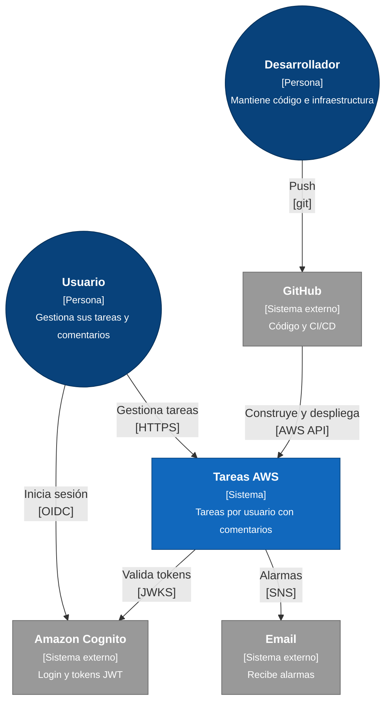

# Nivel 1: Contexto del sistema

Este nivel muestra **quién usa el sistema y con qué sistemas externos se relaciona**, sin detalles técnicos internos.

## Elementos

| Elemento | Tipo | Responsabilidad |
|---|---|---|
| **Usuario** | Persona | Usa la app web. Solo ve y modifica sus propias tareas y comentarios |
| **Desarrollador** | Persona | Escribe código, cambia la infraestructura (Terraform) y responde a las alarmas |
| **Tareas AWS** | Sistema (este) | Gestión de tareas por usuario, con comentarios |
| **Amazon Cognito** | Sistema externo | Identidad: user pool, página de login, tokens (access, id y refresh) |
| **GitHub** | Sistema externo | Código fuente y 4 pipelines (frontend, backend, comentarios, Terraform) |
| **Email** | Sistema externo | Destino de las alarmas (SNS) |

## Decisiones a este nivel

- **Identidad delegada en Cognito:** el sistema nunca ve contraseñas. Solo recibe y valida JWT firmados.
- **Un usuario = un `sub` de Cognito:** es la llave de autorización en todo el sistema (backend, comentarios y base de datos).
- **El despliegue lo hace GitHub, no una persona:** todo cambio a producción pasa por un pipeline. Terraform requiere además una aprobación manual (`aplicar=true`).
