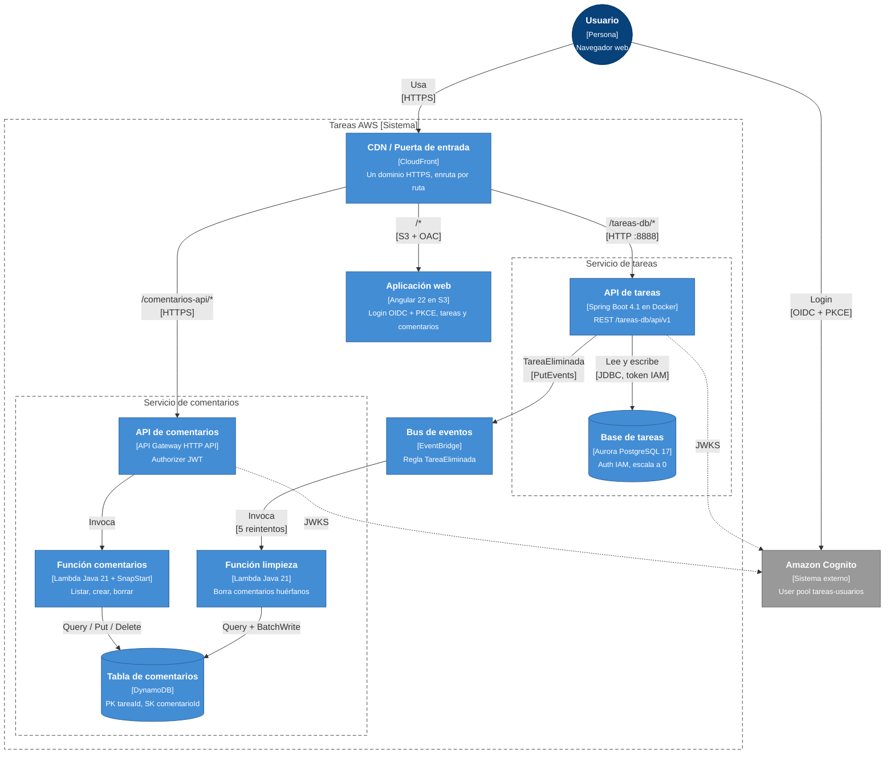

# Nivel 2: Contenedores

Un "contenedor" en C4 es **algo que se ejecuta o almacena datos por separado**: una app web, una API, una función o una base de datos. No significa necesariamente un contenedor Docker.

## Contenedores

| Contenedor | Tecnología | Código | Despliegue |
|---|---|---|---|
| CDN / Puerta de entrada | CloudFront + CloudFront Function `spa-rewrite` | `infra/cloudfront.tf` | Terraform |
| Aplicación web | Angular 22, angular-auth-oidc-client | `frontend/` | `deploy-frontend.yml` → S3 + invalidación |
| API de tareas | Spring Boot 4.1, JPA, Flyway, Spring Security | `backend/tareas-db/` | `deploy-backend.yml` → ECR → EC2 (Docker, vía SSM) |
| Base de tareas | Aurora PostgreSQL 17 (Express, IAM) | migraciones en `backend/.../db/migration` | CLI + import a Terraform |
| API de comentarios | API Gateway HTTP API + authorizer JWT | `serverless/comentarios/template.yaml` | `deploy-comentarios.yml` (SAM) |
| Función comentarios | Lambda Java 21 arm64 + SnapStart | `serverless/comentarios/function/` (`Handler`) | SAM |
| Función limpieza | Lambda Java 21 arm64 + SnapStart | `serverless/comentarios/function/` (`LimpiezaHandler`) | SAM |
| Tabla de comentarios | DynamoDB on-demand | `template.yaml` | SAM (`DeletionPolicy: Retain`) |
| Bus de eventos | EventBridge (bus `default`) | regla en `template.yaml` | SAM |

## Contratos entre contenedores

| Origen → destino | Contrato |
|---|---|
| SPA → API de tareas | REST JSON. Header `Authorization: Bearer <access token>`. Respuesta `{code, message, data}` |
| SPA → API de comentarios | REST JSON, mismo header y mismo formato de respuesta |
| API de tareas → EventBridge | `source: tareas-db`, `detail-type: TareaEliminada`, `detail: {"tareaId": <número>}`. Se publica **solo después del commit** |
| CloudFront → API de tareas | HTTP por el puerto 8888. El security group acepta solo la *prefix list* de CloudFront |

## Decisiones a este nivel

- **Dos estilos de cómputo a propósito:** la API de tareas es un servicio de larga vida (EC2 + Docker, con pool de conexiones a Aurora); los comentarios son serverless (Lambda + DynamoDB). Es parte del aprendizaje y muestra los compromisos de cada uno.
- **Una base de datos por servicio:** las tareas en PostgreSQL (relacional, con restricciones) y los comentarios en DynamoDB (llave-valor, acceso por `tareaId`). Ningún servicio lee la base del otro.
- **Integración asíncrona por eventos:** borrar una tarea no llama a la API de comentarios. Publica un evento, y el servicio de comentarios reacciona. Si la limpieza falla, el usuario no recibe un error.
- **Un solo dominio en CloudFront:** evita CORS y concentra TLS, caché y rutas en un solo lugar.
