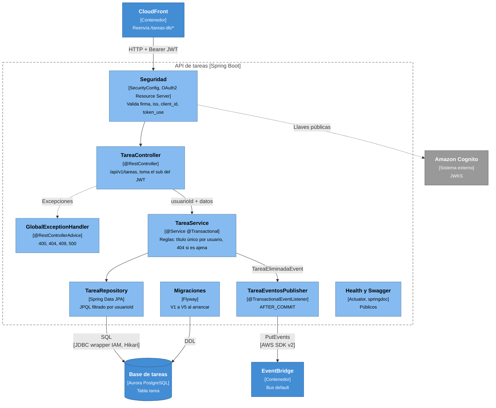

# Nivel 3: Componentes de la API de tareas

Contenedor: **API de tareas** (`backend/tareas-db`, Spring Boot 4.1, paquete `cl.backend.tareas_db`).

## Componentes

| Componente | Clase / paquete | Responsabilidad |
|---|---|---|
| Seguridad | `config.SecurityConfig` | Cadena de filtros sin estado ni CSRF. Rutas públicas: `OPTIONS`, `/api/health`, Swagger. `JwtDecoder` con 3 validadores |
| TareaController | `controller.TareaController` | `GET` listar / `findById` / `findByTitulo` / `findByCompletada`, `POST` crear (201), `PATCH /{id}/completada`, `DELETE /{id}` (204) |
| TareaService | `service.TareaService` | Cada método recibe el `usuarioId`. Las tareas ajenas responden 404, no 403, para no revelar que existen. El dueño sale del token, nunca del body |
| TareaRepository | `repository.TareaRepository` | `findAllDto`, `findByTitulo`, `findByCompletada` (con `Slice`), `findByIdAndUsuarioId`, `existsByUsuarioIdAndTitulo` |
| Modelo | `model.entity.Tarea`, `model.dto.TareaDTO`, `util.ParseoUtil` | La entidad tiene `usuarioId`. El DTO no lo expone |
| TareaEventosPublisher | `evento.TareaEventosPublisher` | Solo existe si `eventos.habilitados=true` (perfil `aws`). Publica después del commit; si falla, lo registra y no afecta al usuario |
| GlobalExceptionHandler | `exception.*` | `ResourceNotFoundException` → 404, `DuplicateResourceException` → 409, validación → 400 |
| Migraciones | `resources/db/migration` | `ddl-auto=validate`: Hibernate solo verifica; los cambios de esquema van siempre en migraciones |

## Flujo de una petición

1. `GET /tareas-db/api/v1/tareas` llega por CloudFront con `Authorization: Bearer ...`.
2. **Seguridad** valida el JWT (las llaves se descargan en la primera petición y luego quedan en caché).
3. **TareaController** recibe `@AuthenticationPrincipal Jwt` y pasa `jwt.getSubject()` al servicio.
4. **TareaService** delega en el repositorio dentro de una transacción de solo lectura.
5. **TareaRepository** ejecuta `... WHERE t.usuarioId = :usuarioId` y devuelve un `Slice<TareaDTO>`.
6. El controller lo envuelve en `ControllerResponse { code, message, data: PageResponse }`.

## Configuración por perfil

| Aspecto | Por defecto (local / CI) | Perfil `aws` |
|---|---|---|
| Conexión | `jdbc:postgresql`, usuario y contraseña (`DB_*`) | `jdbc:aws-wrapper` + plugin IAM (`RDS_DB_*`), sin contraseña |
| Pool Hikari | 2–10 conexiones | 0–5, se vacía a los 60 s para que Aurora pueda pausarse |
| Eventos | Desactivados | `eventos.habilitados=true` |
