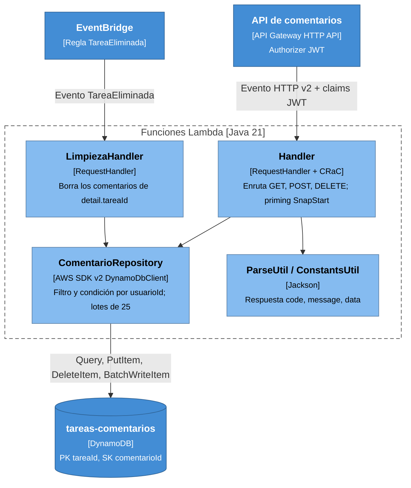

# Nivel 3: Componentes del servicio de comentarios

Contenedores: **Función comentarios** y **Función limpieza**. Comparten el mismo artefacto (`serverless/comentarios/function`, paquete `cl.mario.comentarios`).

## Componentes

| Componente | Responsabilidad |
|---|---|
| `Handler` | Rutas `GET`/`POST /comentarios-api/tareas/{tareaId}/comentarios` y `DELETE .../{comentarioId}`. Sin `sub` → 401; `tareaId` no numérico → 400; texto vacío o mayor a 500 caracteres → 400; cualquier otro error → 500, con el detalle solo en CloudWatch |
| `LimpiezaHandler` | Reacciona a `TareaEliminada`. Si lanza una excepción, EventBridge reintenta hasta 5 veces durante 1 hora |
| `ComentarioRepository` | El cliente DynamoDB se crea una sola vez y queda en la "foto" de SnapStart. Listar usa `FilterExpression usuarioId = :u`; borrar usa `ConditionExpression usuarioId = :u` (`ConditionalCheckFailedException` → 404) |
| `ParseUtil` / `ConstantsUtil` | Formato de respuesta común y lectura tolerante de atributos (los items antiguos sin `usuario` no rompen la lectura) |
| Modelo `Comentario` | `record (tareaId, comentarioId, texto, creadoEn, autor)` |

## Modelo de datos (DynamoDB)

| Atributo | Tipo | Rol |
|---|---|---|
| `tareaId` | N | Llave de partición |
| `comentarioId` | S | Llave de orden: `<epoch ms de 13 dígitos>-<8 hex>`, ordenable por fecha |
| `texto` | S | Máximo 500 caracteres |
| `creadoEn` | S | ISO-8601 |
| `usuario` | S | Nombre que se muestra (claim `username`) |
| `usuarioId` | S | `sub` de Cognito del autor: autorización |

## Decisiones

- **Arranque en frío:** SnapStart y *priming* en `beforeCheckpoint`. Se hace una consulta real con `tareaId = -1` y se serializa una respuesta, para que el SDK, TLS y Jackson queden cargados en la foto.
- **Autorización por autor y no por dueño de la tarea:** la Lambda no consulta al backend, para mantener los servicios desacoplados. El efecto es que solo ves y borras tus propios comentarios.
- **El filtro se aplica después de leer:** `Limit 50` se cuenta antes del filtro. Es aceptable porque una tarea pertenece a un solo usuario.
