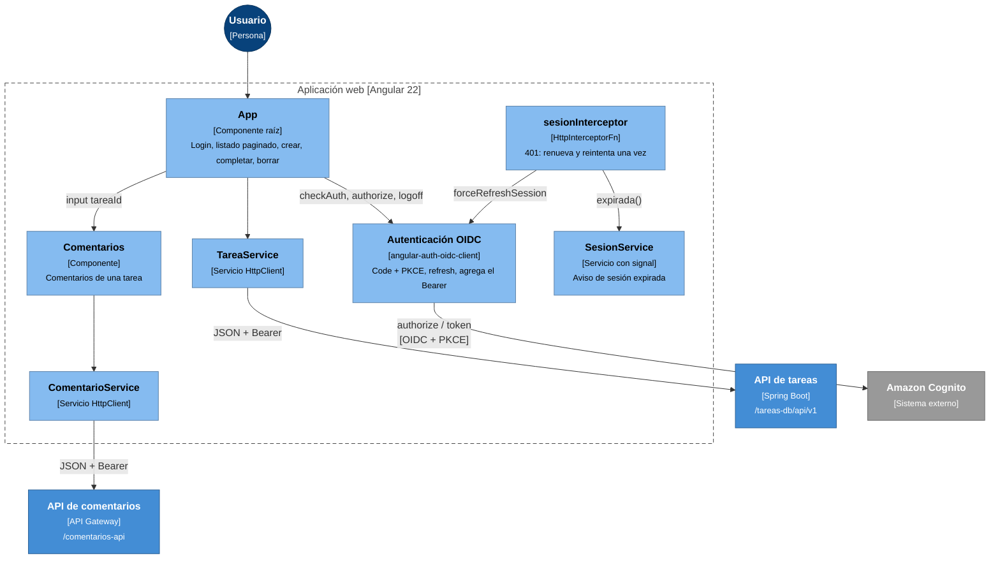

# Nivel 3: Componentes de la aplicación web

Contenedor: **Aplicación web** (`frontend/`, Angular 22 standalone con signals).

## Componentes

| Componente | Archivo | Responsabilidad |
|---|---|---|
| `App` | `app.ts`, `app.html` | Estado con signals (`tareas`, `pagina`, `hayMas`, `error`, `comentariosAbiertos`). Muestra un solo panel de comentarios a la vez |
| `Comentarios` | `comentarios/` | Recibe `tareaId` y gestiona los comentarios de esa tarea |
| `TareaService` | `service/tarea.service.ts` | Lista paginada (orden `creadaEn,desc`), crear, `PATCH /completada`, borrar. Desempaqueta `ControllerResponse.data` |
| `ComentarioService` | `service/comentario.service.ts` | Listar, crear y borrar comentarios |
| Autenticación OIDC | `app.config.ts`, `auth.config.ts` | `responseType: code`, `useRefreshToken`, `silentRenew`, renovación 60 s antes del vencimiento, `secureRoutes` = solo las dos APIs |
| `sesionInterceptor` | `interceptor/` | Se ejecuta después de `authInterceptor`. Marca los reintentos con `HttpContextToken` para no entrar en un ciclo |
| `SesionService` | `service/sesion.service.ts` | Signal `aviso` que muestra la barra "Tu sesión expiró" |

## Decisiones

- **Rutas relativas (`/tareas-db`, `/comentarios-api`):** en producción las resuelve CloudFront y en desarrollo `proxy.conf.json`. El código no cambia entre entornos.
- **El token solo va a las APIs propias** (`secureRoutes`), nunca a terceros.
- **Sin backend-for-frontend:** la SPA es un cliente público (sin client secret), por eso usa PKCE.
