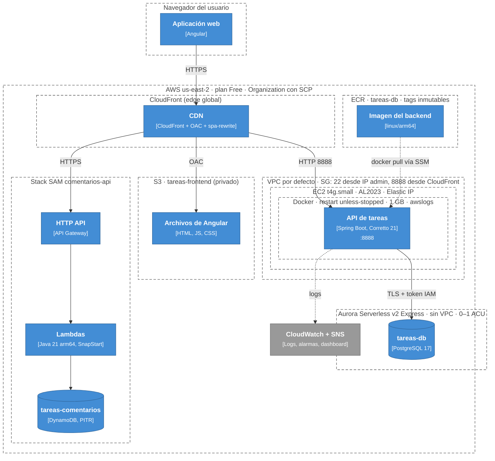
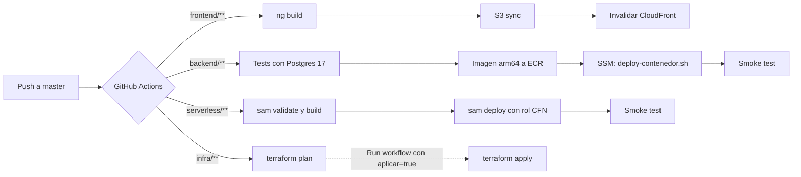

# Diagrama de despliegue

Muestra **dónde corre cada contenedor** en la infraestructura de AWS (región `us-east-2`) y cómo llega a producción.

## Infraestructura por nodo

| Nodo | Recurso | Definido en |
|---|---|---|
| CloudFront | `aws_cloudfront_distribution.app`, OAC, `spa-rewrite` | `infra/cloudfront.tf` |
| S3 | `tareas-frontend-mario-2026` | `infra/s3.tf` |
| EC2 | `aws_instance.backend` + Elastic IP + security group + rol `tareas-backend-ec2` | `infra/ec2.tf`, `infra/iam.tf` |
| Aurora | `aws_rds_cluster.tareas` + `tareas_1` | `infra/aurora.tf` (creado por CLI e importado) |
| ECR | `aws_ecr_repository.backend` | `infra/ecr.tf` |
| API Gateway, Lambdas, DynamoDB, regla EventBridge | Stack `comentarios-api` | `serverless/comentarios/template.yaml` |
| Cognito | User pool, cliente `tareas-angular`, dominio de login | `infra/cognito.tf` |
| Observabilidad | Log group, 6 alarmas, SNS, dashboard | `infra/observabilidad.tf` |

## Pipeline de entrega

## Identidades y permisos

| Identidad | Tipo | Puede |
|---|---|---|
| `tareas-backend-ec2` | Rol de la EC2 | `rds-db:connect` como `tareas_app`, `events:PutEvents`, descargar de ECR, escribir logs, SSM |
| Roles de las Lambdas | Roles creados por SAM | CRUD solo sobre `tareas-comentarios` |
| `comentarios-cfn-exec` | Rol de CloudFormation | Crear y actualizar el stack de SAM (permisos acotados por prefijo) |
| `github-deploy` | Usuario IAM (access keys) | S3 del frontend, invalidar CloudFront, push a ECR, `ssm:SendCommand` a la EC2, desplegar el stack de SAM |
| `github-terraform-plan` | Usuario IAM | `ReadOnlyAccess` + state |
| `github-terraform-apply` | Usuario IAM | `AdministratorAccess`, solo en ejecuciones manuales |
