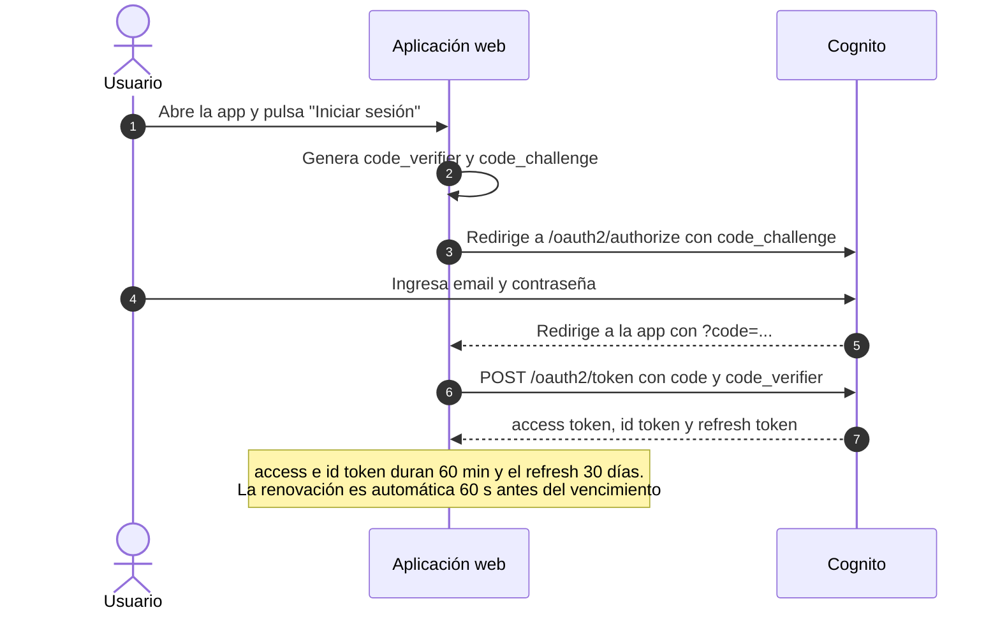
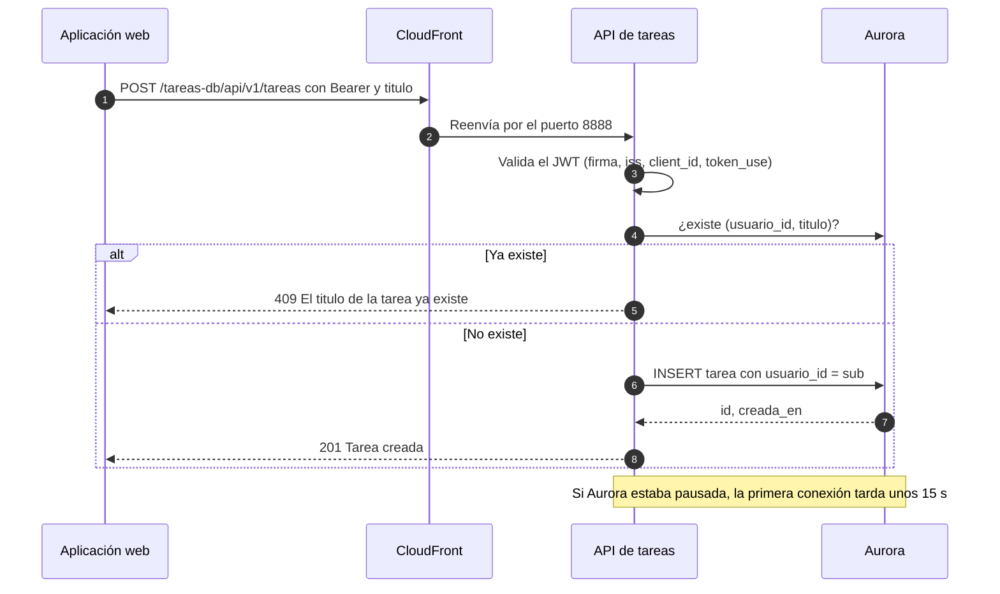
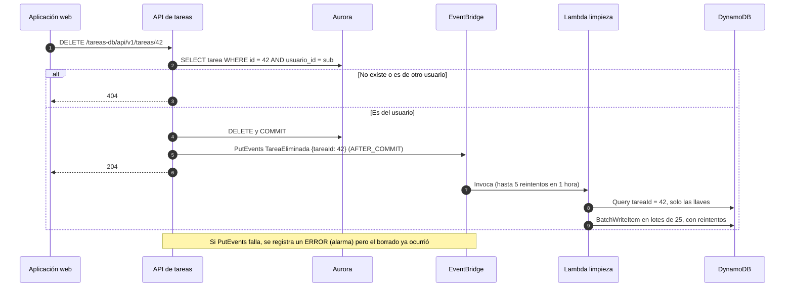
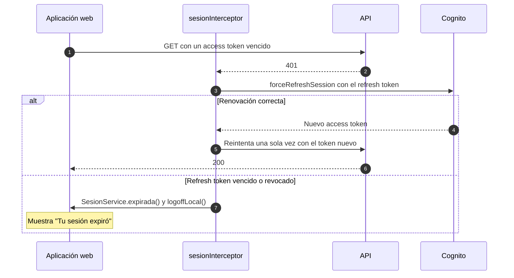
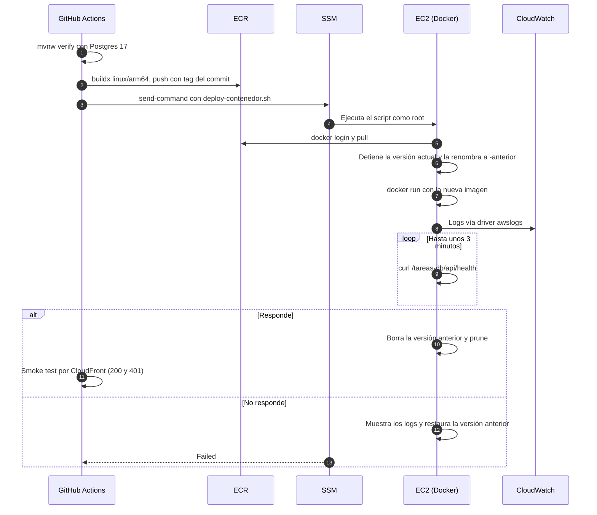

# Diagramas dinámicos

Escenarios clave en orden temporal. Se usan diagramas de secuencia, que se leen mejor que el formato `C4Dynamic` cuando hay muchos pasos.

## 1. Inicio de sesión (Authorization Code + PKCE)

## 2. Crear una tarea

## 3. Borrar una tarea y limpiar sus comentarios (asíncrono)

## 4. Token vencido durante el uso

## 5. Despliegue del backend

